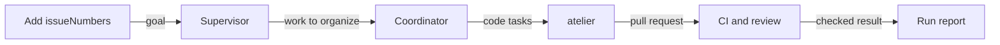

# stable

Give Stable a coding goal and a repository. It returns a reviewed pull request
and a run report without you staying at the keyboard.

## Install

Install Stable 0.1.0 with Homebrew:

```sh
brew install stevenjpx2/taps/stable
```

## First setup

Choose models, worker capacity, budgets, and completion checks in
`stable.config.ts`:

```ts
export default {
  coordinator: { model: "anthropic/claude-opus-5-5" },
  workers: { model: "openai/gpt-6.2-sol", max: 4 },
  budget: { usd: 20, hours: 2 },
  done: ["ci green", "review clean"],
};
```

This example gives each run $20 and two hours. Completion requires green CI
and a clean review.

## Add a feature to Sourcefed

Ask Stable to add `issueNumbers` to Sourcefed's `github-issues` integration:

```sh
stable run "add issueNumbers to github-issues" --repo wrkhse/sourcefed
```



The supervisor oversees the run. The coordinator breaks the goal into tasks
and assigns workers. For code tasks, it calls atelier to prepare a pull request
for CI and review. Workers run in sandboxes under their session grants.

## Follow a run

```sh
stable status
```

The CLI shows every run, its agents, and what each worker is waiting on, such as
another task's result, a review, or completion checks. Use the status page to
follow the work in a browser, or receive run events through sourcefed.

## Roadmap

- [ ] Unattended runs with atelier delegation and review
- [ ] Per-run time and money budgets, CLI status, status page, and sourcefed events
- [ ] Publish stable 0.1.0 to the wrkhse/tap tap

## More

- [Design](https://github.com/wrkhse/stable/issues/1)
- [Harness notes](https://github.com/wrkhse/tack/issues/26)
- [Workhorse philosophy](https://github.com/wrkhse/workhorse/blob/main/PHILOSOPHY.md)
